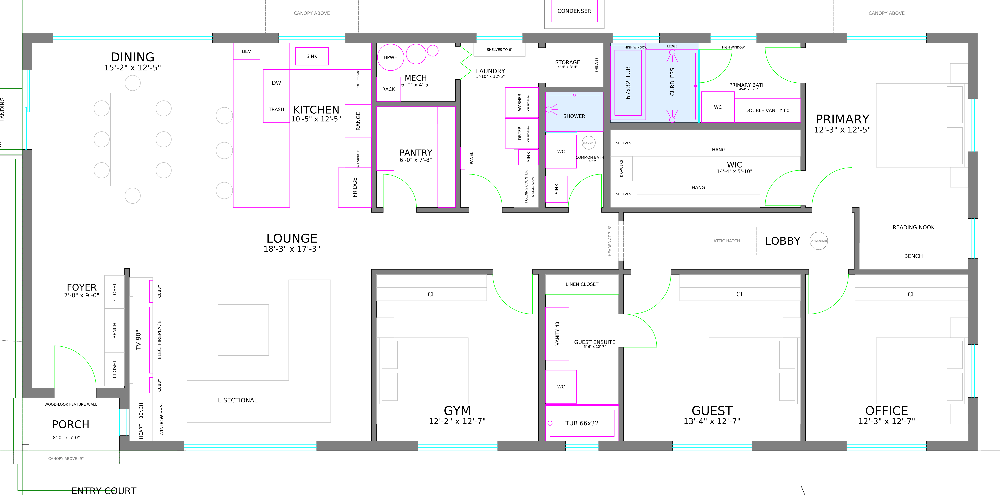
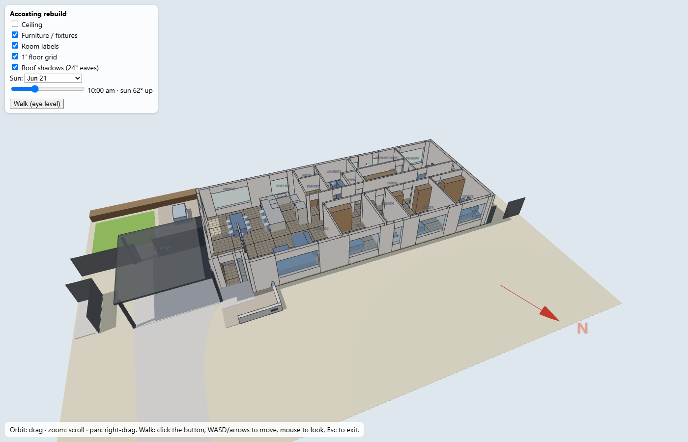

# Accosting rebuild: floor plan and design wishlist

220 Laurel Dr, Altadena. All-electric, single-story Eaton Fire rebuild. Updated Oct 13, 2026 · @Richard

*Current plan: the designer's 12 OCT 26 sheet with owner edits 1–21 applied. Street (plan north) at the bottom, carport (plan east) on the left; the arrow in the front yard shows true north (21° off plan north).*

## Owner schematic (accurate walls)

`Accosting - owner schematic.dxf` is a clean drawing of the same plan, drawn from scratch with no designer content. Exterior walls are 9" (2x6 + sheathing + 1" rigid insulation + stucco), interior walls 4½", plumbing walls 6½". Room sizes are clear dimensions, finish face to finish face. All dimensions and openings are numbers at the top of `scripts/schematic.py`; change one and run `uv run scripts/schematic.py`. Not for construction.

[Full site sheet](renders/schematic.png)

## 3D massing model

Open [`renders/3d/house.html`](renders/3d/house.html) in a browser (orbit, zoom, toggle ceiling/furniture, and a **Walk** button for eye-level WASD navigation). The same geometry is in `renders/3d/house.obj` for Windows 3D Viewer or Blender. Regenerate with `uv run scripts/make_3d.py` after the plan changes.

## Design wishlist by trade

1. [Project basics](docs/01-project-basics.md): orientation, key decisions, code basis
2. [Architect: floor plan, roof, finishes](docs/02-floor-plan.md): rooms, entry, pantry/laundry/mech block, bedroom wing, attic, wildfire
3. [Site, carport, and landscape](docs/03-site-and-landscape.md): siting, courtyard, bins, fences, outdoor unit, front yard
4. [Plumbing](docs/04-plumbing.md)
5. [HVAC and ventilation](docs/05-hvac.md)
6. [Electrical](docs/06-electrical.md)
7. [Low-voltage and network](docs/07-low-voltage.md)
8. [Kitchen: cabinets and appliances](docs/08-kitchen.md)
9. [Open questions](docs/09-open-questions.md)
10. [Plan change log](docs/10-plan-changes.md): each edit step with its render

## Files

| File | What it is |
| --- | --- |
| `Accosting 13-OCTOBER-2026.dwg` / `.dxf` | Designer's drawing (Illusoire Art). Never modified. |
| `Accosting 13-OCTOBER-2026 - owner edits.dxf` | Generated: designer's drawing + owner edits 1–24 |
| `Accosting 13-OCTOBER-2026 - EXPERIMENT *.dxf` | Generated: alternative layouts for the pantry/laundry/mech/powder block |
| `Accosting - owner schematic.dxf` | Generated: owner-drawn schematic with real wall thicknesses (`scripts/schematic.py`) |
| `scripts/owner_edits.py` | Applies the owner edits and renders PNGs (`uv run scripts/owner_edits.py --render all`) |
| `scripts/experiment_*.py` | Experiments built on the owner edits (`experiment_wetrooms.py` builds on the schematic) |
| `scripts/make_3d.py` | Builds the 3D massing model from the owner-edits DXF |
| `renders/` | PNG renders per step; `renders/experiments/` for the experiments; `renders/3d/` for the 3D model |

Viewing and measuring: open the DXFs in QCAD (View → Auto Zoom; Snap → Endpoint; Info → Distance). Units are inches. Don't save edits into the generated DXFs; they're rebuilt from the designer's original on every run.

The plans are © Illusoire Art; these edits are for owner review and to brief the designer/architect.
