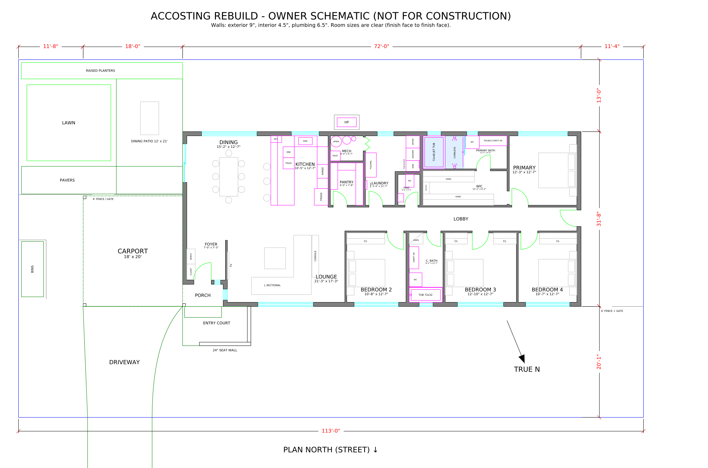
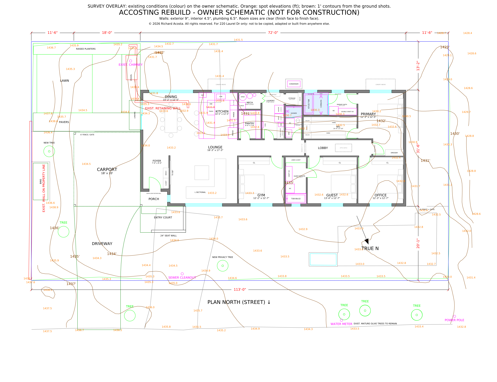
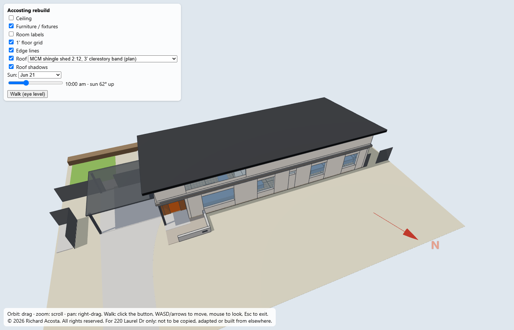

# Accosting rebuild: floor plan and design wishlist

220 Laurel Dr, Altadena. All-electric, single-story Eaton Fire rebuild. Updated Oct 14, 2026 · @Richard

*Owner schematic, not for construction: the full lot with the house, carport, courtyard, fences and a true-north arrow (about 22° off plan north). Street (plan north) at the bottom, carport (plan east) on the left.*

*The house at a larger scale.*

**Download the plan as a DXF: [Accosting - owner schematic.dxf](Accosting%20-%20owner%20schematic.dxf)** (units are inches; opens in QCAD, AutoCAD or any DXF viewer). With the survey underneath: [Accosting - owner schematic + survey.dxf](Accosting%20-%20owner%20schematic%20%2B%20survey.dxf).

Walls are drawn at realistic thicknesses: exterior 9" (2x6 + sheathing + 1" rigid insulation + stucco), interior 4½", plumbing walls 6½". Room sizes on the drawing are clear dimensions, finish face to finish face. Sizes and fine details are the architect's call; the drawing shows one way the [wishlist](#design-wishlist-by-trade) fits.

## Survey overlay

*The topographic survey (`source_files/survey/`) over the schematic: existing walls, the old chimney, paving, fences, trees and utilities in colour; spot elevations in orange; 1' contours in brown. The site falls about 4 ft across the house from the carport end to the primary-suite end. See [site existing conditions](docs/03-site-and-landscape.md#existing-conditions-survey). Combined DXF: [Accosting - owner schematic + survey.dxf](Accosting%20-%20owner%20schematic%20%2B%20survey.dxf).*

## 3D massing model

**[Open the 3D model](https://blotzy.github.io/floorplan/renders/3d/house.html)** (GitHub Pages; GitHub's file view only shows the source). From a local clone, open `renders/3d/house.html` in a browser instead. It has orbit, zoom, toggle ceiling/furniture, a sun-position control, and a **Walk** button for eye-level navigation (WASD + mouse on a computer; on a phone or tablet, a joystick to move and drag to look). The same geometry is in `renders/3d/house.obj` for Windows 3D Viewer or Blender.

*The chosen exterior: midcentury-modern low gable with dark shingles, stucco walls, and the nearly flat carport roof. The model opens with the roof off; tick **Roof** to show it, and untick **Edge lines** for continuous stucco walls without the outlines between wall pieces, or open [house.html#roof](https://blotzy.github.io/floorplan/renders/3d/house.html#roof). The Roof menu also offers the MCM shed alternative, with one continuous sloped ceiling over the lounge, dining and kitchen and a clerestory over the lounge: shingles, 2:12, with a [3' band](https://blotzy.github.io/floorplan/renders/3d/house.html#roof-shed) or [full height](https://blotzy.github.io/floorplan/renders/3d/house.html#roof-shed-full); standing-seam metal, 2:12, with a [3' band](https://blotzy.github.io/floorplan/renders/3d/house.html#roof-metal) or [full height](https://blotzy.github.io/floorplan/renders/3d/house.html#roof-metal-full). There's also the plain shed, with no clerestory and flat 10' ceilings throughout: [shingles](https://blotzy.github.io/floorplan/renders/3d/house.html#roof-shed-plain) or [metal](https://blotzy.github.io/floorplan/renders/3d/house.html#roof-metal-plain).*

## Design wishlist by trade

1. [Project basics](docs/01-project-basics.md): orientation, key decisions, code basis
2. [Architect: floor plan, roof, finishes](docs/02-floor-plan.md): rooms, entry, pantry/laundry/mech block, bedroom wing, attic, wildfire
3. [Site, carport, and landscape](docs/03-site-and-landscape.md): siting, courtyard, bins, fences, outdoor unit, front yard
4. [Plumbing](docs/04-plumbing.md)
5. [HVAC and ventilation](docs/05-hvac.md)
6. [Electrical](docs/06-electrical.md)
7. [Low-voltage and network](docs/07-low-voltage.md)
8. [Kitchen: cabinets and appliances](docs/08-kitchen.md)
9. [Open questions](docs/09-open-questions.md)

## Files

| File | What it is |
| --- | --- |
| [`Accosting - owner schematic.dxf`](Accosting%20-%20owner%20schematic.dxf) | The plan as a DXF (inches) |
| [`Accosting - owner schematic + survey.dxf`](Accosting%20-%20owner%20schematic%20%2B%20survey.dxf) | The plan over the topographic survey as a DXF (inches) |
| Topographic survey: [PDF](source_files/survey/102_220%20Laurel%20Drive%20TOPO_ts4096_101.pdf) · [DWG](source_files/survey/102_220%20Laurel%20Drive%20TOPO_ts4096_101.dwg) · [DXF](source_files/survey/102_220%20Laurel%20Drive%20TOPO_ts4096_101.dxf) | The surveyor's topo of the lot ([folder](https://github.com/blotzy/floorplan/tree/main/source_files/survey)) |
| Plan renders: [site plan](renders/schematic.png) · [house](renders/schematic-zoom.png) · [survey overlay](renders/survey-overlay.png) | The images at the top of this page, full size ([folder](https://github.com/blotzy/floorplan/tree/main/renders)) |
| 3D model: [open in the browser](https://blotzy.github.io/floorplan/renders/3d/house.html) · [with the roof](https://blotzy.github.io/floorplan/renders/3d/house.html#roof) · [OBJ](renders/3d/house.obj) | Walkable 3D model; the OBJ opens in Windows 3D Viewer or Blender |
| Experiments: [exterior styles, street](renders/experiments/exterior-compare-street.png) · [aerial](renders/experiments/exterior-compare-aerial.png) · [metal roofs](renders/experiments/exterior-metal-compare-street.png) · [laundry / mech swap](renders/experiments/utility-swap.png) · [dining and kitchen windows](renders/experiments/south-windows-compare.png) · [shed clerestory: one band, two or three windows](renders/experiments/clerestory-compare.png) · porch details [from the entry court](renders/experiments/porch-compare-court.png) and [from the street](renders/experiments/porch-compare-street.png) | Alternatives explored, each with its own 3D model ([folder](https://github.com/blotzy/floorplan/tree/main/renders/experiments)) |

Viewing and measuring: open the DXFs in QCAD (View → Auto Zoom; Snap → Endpoint; Info → Distance). Units are inches.
